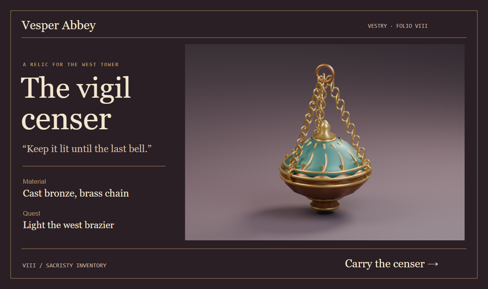
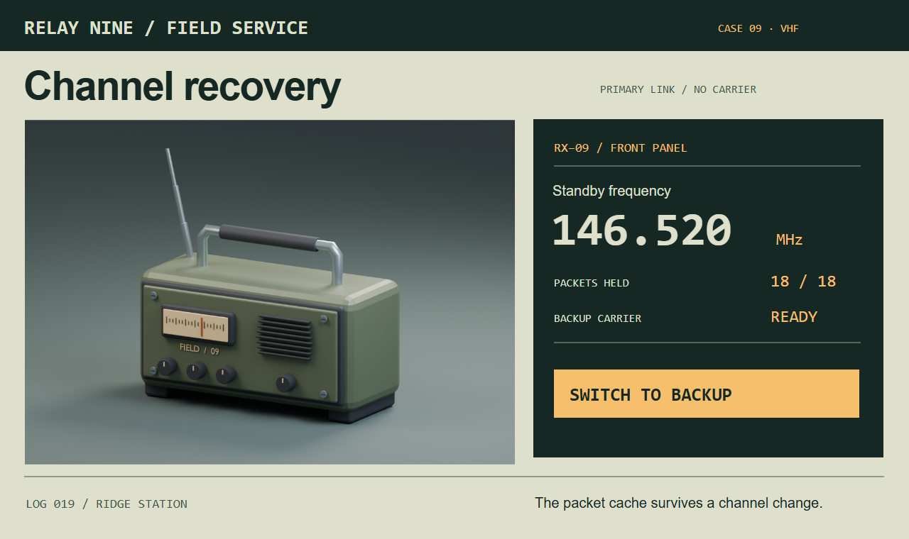
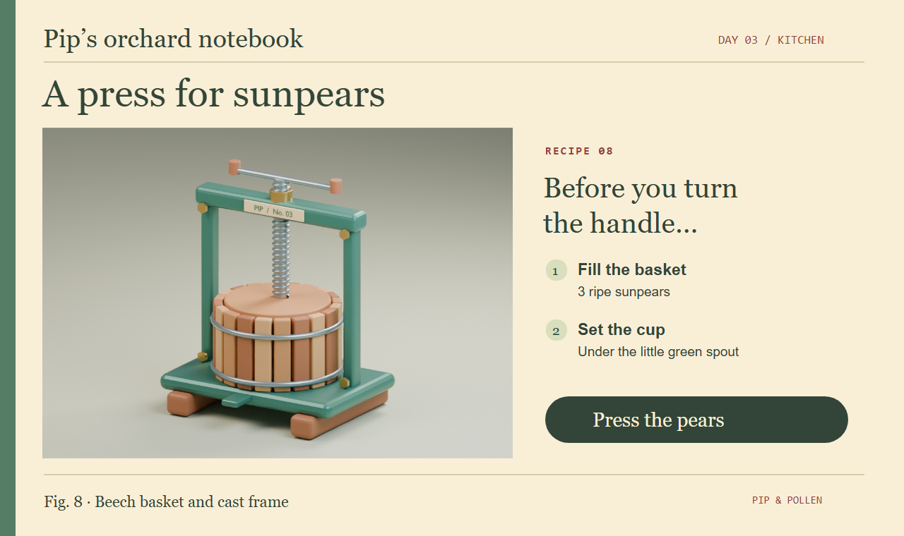
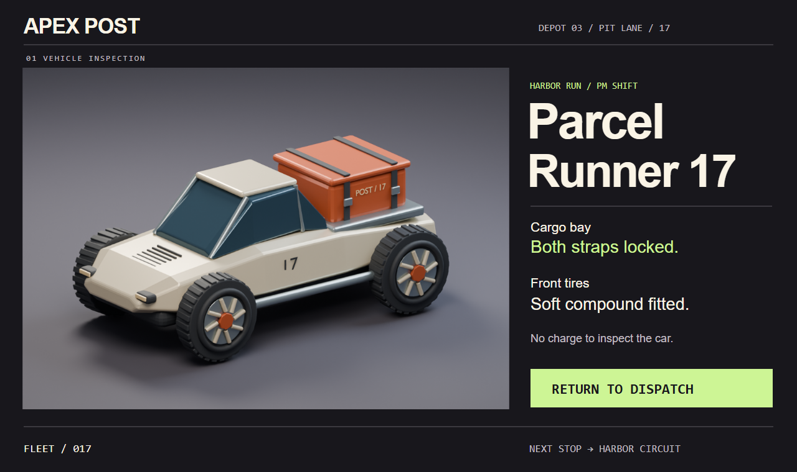

# Game UI Atlas

Четыре вымышленные игры, двадцать игровых окон. В аббатстве игрок выбирает реликвию, в полевой экспедиции чинит связь, в саду варит джем, в ночном порту доставляет посылку. Это учебные дизайн-кейсы: здесь можно рассмотреть интерфейсы и забрать графику, но играть в них нельзя.

**[Открыть подборку в Figma](https://www.figma.com/design/PcRRfGqam04HT5VkCCzrUK/Game-UI-Atlas?node-id=2-15)** · [Скачать коллекцию целиком](https://github.com/German4341374/GameUIAtlas/archive/refs/heads/main.zip)

| [Vesper Abbey · тёмная RPG](studies/vesper/) | [Relay Nine · тактический интерфейс](studies/relay/) |
| --- | --- |
|  |  |
| [**Pip & Pollen · казуальная игра**](studies/pollen/) | [**Apex Post · аркадные гонки**](studies/apex/) |
|  |  |

### Что можно разобрать

В каждой серии теперь есть предмет, который можно открыть в Blender: [курьерская машина](studies/apex/model/prop.glb), [кадило](studies/vesper/model/prop.glb), [приёмник](studies/relay/model/prop.glb) и [фруктовый пресс](studies/pollen/model/prop.glb). Четыре новых композиции выше — рендеры этих моделей внутри интерфейсов. Исходный Figma-файл по ссылке содержит прежние векторные экраны; новые листы доступны для импорта в SVG.

### Как смотреть

У каждой серии четыре экрана в Figma и ещё один большой экран в SVG. Нажмите на превью выше — откроется разбор с прямой ссылкой на каждый фрейм. Для быстрого просмотра GitHub достаточно; вход в Figma не нужен, чтобы посмотреть картинки.

| Дополнительный экран | Задача игрока |
| --- | --- |
| [The vigil censer](studies/vesper/detail.svg) | Прочитать назначение реликвии. |
| [Channel recovery](studies/relay/detail.svg) | Проверить резервный канал и очередь пакетов. |
| [A press for sunpears](studies/pollen/detail.svg) | Подготовить пресс к работе. |
| [Parcel Runner 17](studies/apex/detail.svg) | Осмотреть крепления груза и шины. |

[Как пересобрать модели и рендеры](tools/WORKSHOP.md).

В папках серий также лежат 16 иллюстраций и 16 иконок в SVG. Все иллюстрации относятся к вымышленным играм; присланные референсы в репозиторий не входят.
