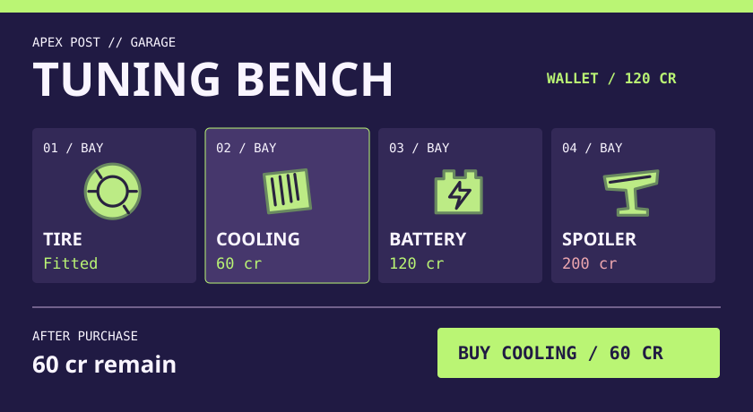

# Apex Post · Arcade courier

Курьер принимает заказ, меняет резину, едет через порт и сверяется с целевым временем уже после финиша.

[Открыть серию в Figma](https://www.figma.com/design/PcRRfGqam04HT5VkCCzrUK/Game-UI-Atlas?node-id=2-1273) · [Увеличить превью](overview.png)

### На что посмотреть

В гараже важны ресурс и выбор шин, на трассе — сектор и следующий сплит. На финише время гонки и выигранные секунды разведены по разным строкам. Сравните цель 01:32.0 на старте и 01:29.4 на финише. Разница −2,6 секунды показывается отдельно от награды за доставку.

| Окно | Что видит игрок |
| --- | --- |
| [NIGHT SHIFT](https://www.figma.com/design/PcRRfGqam04HT5VkCCzrUK/Game-UI-Atlas?node-id=2-1275) | Harbor circuit: 2.8 km · Target time: 01:32.0 |
| [PIT WINDOW](https://www.figma.com/design/PcRRfGqam04HT5VkCCzrUK/Game-UI-Atlas?node-id=2-1344) | Soft compound: Grip +12 · Delivery credits: 80 / 120 |
| [HARBOR LOOP](https://www.figma.com/design/PcRRfGqam04HT5VkCCzrUK/Game-UI-Atlas?node-id=2-1416) | Checkpoint: 02 / 03 · Time to beat: 00:29.4 |
| [SIGNED FOR](https://www.figma.com/design/PcRRfGqam04HT5VkCCzrUK/Game-UI-Atlas?node-id=2-1480) | Finish time: 01:29.4 · Personal best: −2.6 s |

### Пятый экран: Tuning bench

Этот дополнительный экран приложен как [редактируемый SVG](detail.svg), а не как часть облачного макета. Скачайте файл и перетащите его на холст Figma. Векторные рисунки лежат в [art/](art/), отдельные иконки — в [icons/](icons/). При импорте SVG системный шрифт может отличаться.

В исходном макете: Barlow Condensed и DM Sans. Цвета: `#201A43` · `#332957` · `#F9F5FF` · `#BAF574` · `#46376C`.

[← Все серии](../../README.md)
