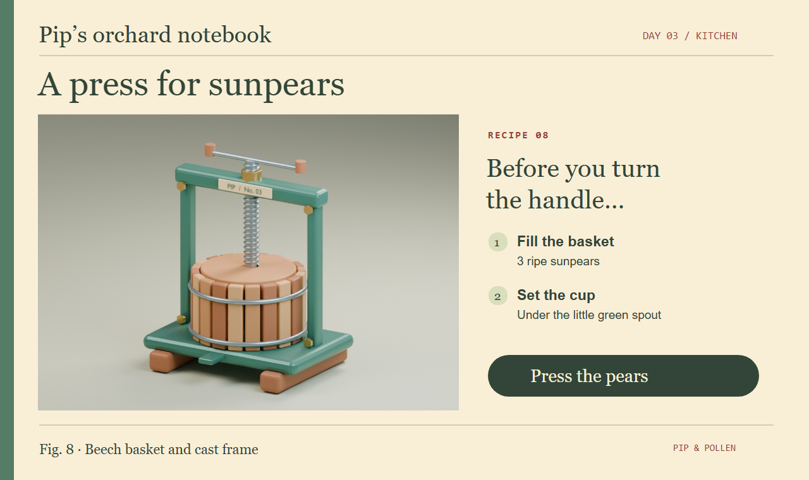
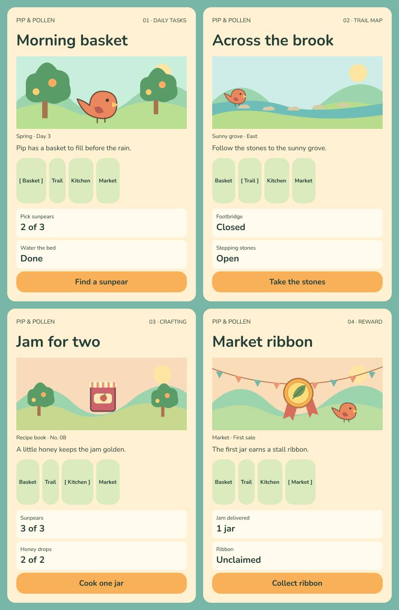

# Pip & Pollen · Cozy orchard

Птичка Пип собирает груши. Чтобы добраться до рощи, ей нужно обойти закрытый мост, приготовить джем и забрать ленточку на рынке.

### A press for sunpears · предметный экран

В книге рецептов показан пресс целиком. Ребёнку не нужно знать устройство винта: подпись подсказывает, что положить в корзину и куда подставить чашку.

[Скачать модель GLB](model/prop.glb) · [Рендер без интерфейса](model/studio.png) · [Макет SVG для импорта в Figma](detail.svg)

В облачной Figma ниже оставлены четыре исходных векторных экрана.

[Открыть серию в Figma](https://www.figma.com/design/PcRRfGqam04HT5VkCCzrUK/Game-UI-Atlas?node-id=2-1057) · [Увеличить превью](overview.png)

### На что посмотреть

Тёплый фон и округлые буквы оставляют интерфейс похожим на книжку. Крупные рисунки помогают узнать место; количество ингредиентов и доступность маршрута остаются текстом. Посмотрите на переход от корзины к рецепту: сначала не хватает одной груши, в кухне уже есть 3 из 3. Получение ленты — отдельное действие после доставки.

| Окно | Что видит игрок |
| --- | --- |
| [Morning basket](https://www.figma.com/design/PcRRfGqam04HT5VkCCzrUK/Game-UI-Atlas?node-id=2-1059) | Pick sunpears: 2 of 3 · Water the bed: Done |
| [Across the brook](https://www.figma.com/design/PcRRfGqam04HT5VkCCzrUK/Game-UI-Atlas?node-id=2-1106) | Footbridge: Closed · Stepping stones: Open |
| [Jam for two](https://www.figma.com/design/PcRRfGqam04HT5VkCCzrUK/Game-UI-Atlas?node-id=2-1155) | Sunpears: 3 of 3 · Honey drops: 2 of 2 |
| [Market ribbon](https://www.figma.com/design/PcRRfGqam04HT5VkCCzrUK/Game-UI-Atlas?node-id=2-1207) | Jam delivered: 1 jar · Ribbon: Unclaimed |

[← Все серии](../../README.md)
