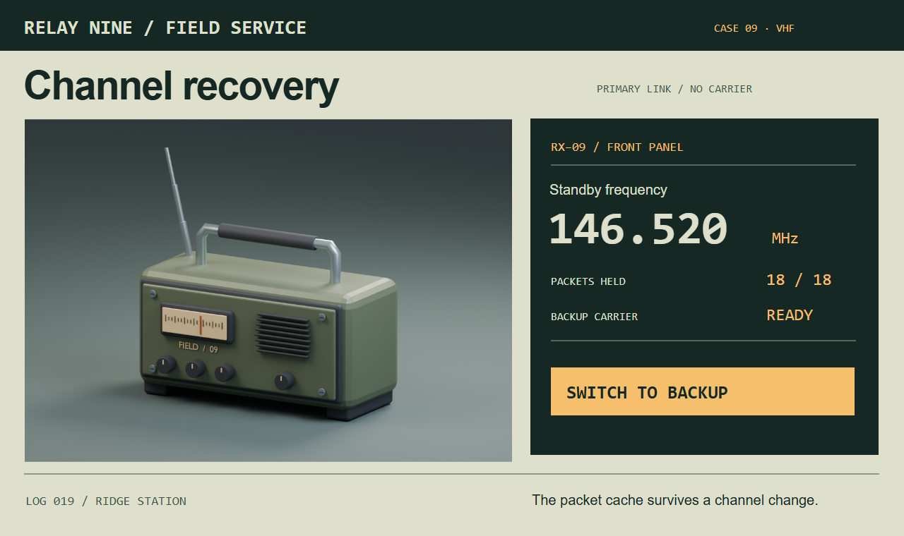
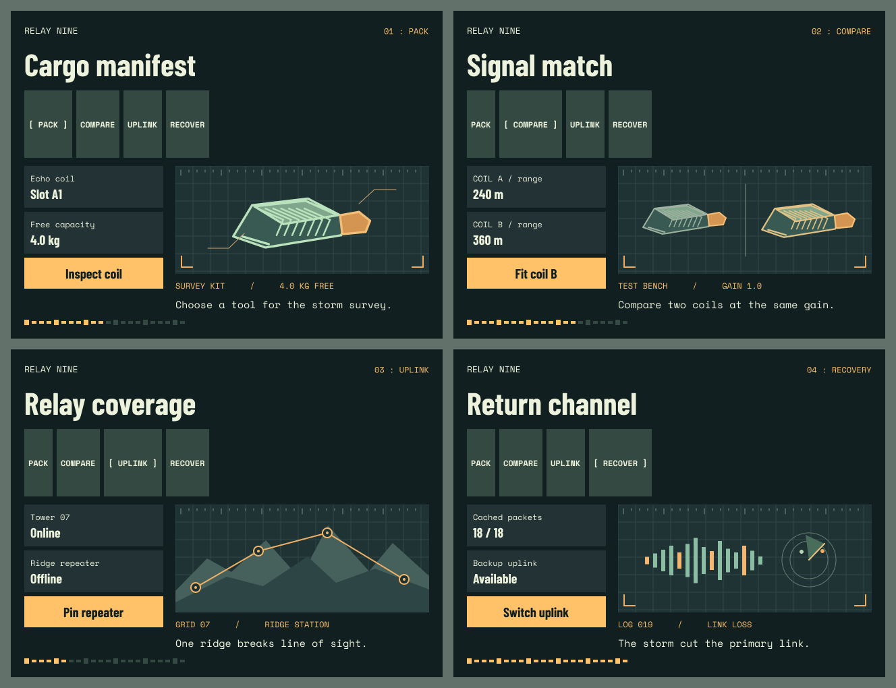

# Relay Nine · Survey tactics

Геодезическая группа восстанавливает связь после шторма. В комплекте две катушки, а за хребтом пропал один ретранслятор.

### Channel recovery · предметный экран

У прибора есть механическая шкала, переключатели и выдвижная антенна. Справа отдельно вынесено состояние связи: можно ли перейти на резервный канал, сохранив накопленные пакеты.

[Скачать модель GLB](model/prop.glb) · [Рендер без интерфейса](model/studio.png) · [Макет SVG для импорта в Figma](detail.svg)

В облачной Figma ниже оставлены четыре исходных векторных экрана.

[Открыть серию в Figma](https://www.figma.com/design/PcRRfGqam04HT5VkCCzrUK/Game-UI-Atlas?node-id=2-542) · [Увеличить превью](overview.png)

### На что посмотреть

Вместо картинок оружия здесь полевые приборы. Сравнение ведётся при одинаковом усилении; метры, вес и состояние связи написаны рядом со значениями. Откройте сравнение: вторая катушка даёт 360 м вместо 240 м. На следующем экране видно, почему одной дальности мало: хребет закрывает прямую видимость.

| Окно | Что видит игрок |
| --- | --- |
| [Cargo manifest](https://www.figma.com/design/PcRRfGqam04HT5VkCCzrUK/Game-UI-Atlas?node-id=2-544) | Echo coil: Slot A1 · Free capacity: 4.0 kg |
| [Signal match](https://www.figma.com/design/PcRRfGqam04HT5VkCCzrUK/Game-UI-Atlas?node-id=2-663) | COIL A / range: 240 m · COIL B / range: 360 m |
| [Relay coverage](https://www.figma.com/design/PcRRfGqam04HT5VkCCzrUK/Game-UI-Atlas?node-id=2-795) | Tower 07: Online · Ridge repeater: Offline |
| [Return channel](https://www.figma.com/design/PcRRfGqam04HT5VkCCzrUK/Game-UI-Atlas?node-id=2-916) | Cached packets: 18 / 18 · Backup uplink: Available |

[← Все серии](../../README.md)
