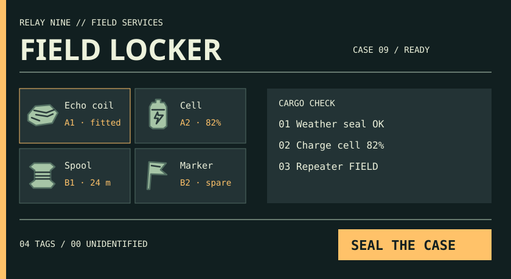

# Relay Nine · Survey tactics

Геодезическая группа восстанавливает связь после шторма. В комплекте две катушки, а за хребтом пропал один ретранслятор.

[Открыть серию в Figma](https://www.figma.com/design/PcRRfGqam04HT5VkCCzrUK/Game-UI-Atlas?node-id=2-542) · [Увеличить превью](overview.png)

### На что посмотреть

Вместо картинок оружия здесь полевые приборы. Сравнение ведётся при одинаковом усилении; метры, вес и состояние связи написаны рядом со значениями. Откройте сравнение: вторая катушка даёт 360 м вместо 240 м. На следующем экране видно, почему одной дальности мало: хребет закрывает прямую видимость.

| Окно | Что видит игрок |
| --- | --- |
| [Cargo manifest](https://www.figma.com/design/PcRRfGqam04HT5VkCCzrUK/Game-UI-Atlas?node-id=2-544) | Echo coil: Slot A1 · Free capacity: 4.0 kg |
| [Signal match](https://www.figma.com/design/PcRRfGqam04HT5VkCCzrUK/Game-UI-Atlas?node-id=2-663) | COIL A / range: 240 m · COIL B / range: 360 m |
| [Relay coverage](https://www.figma.com/design/PcRRfGqam04HT5VkCCzrUK/Game-UI-Atlas?node-id=2-795) | Tower 07: Online · Ridge repeater: Offline |
| [Return channel](https://www.figma.com/design/PcRRfGqam04HT5VkCCzrUK/Game-UI-Atlas?node-id=2-916) | Cached packets: 18 / 18 · Backup uplink: Available |

### Пятый экран: Field locker

Этот дополнительный экран приложен как [редактируемый SVG](detail.svg), а не как часть облачного макета. Скачайте файл и перетащите его на холст Figma. Векторные рисунки лежат в [art/](art/), отдельные иконки — в [icons/](icons/). При импорте SVG системный шрифт может отличаться.

В исходном макете: Barlow Condensed и Space Mono. Цвета: `#111F20` · `#233335` · `#EDF2DC` · `#FFC269` · `#344941`.

[← Все серии](../../README.md)
