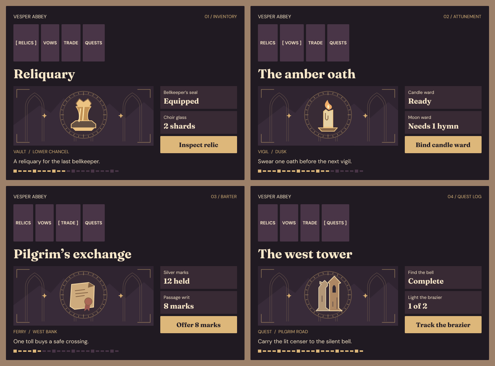
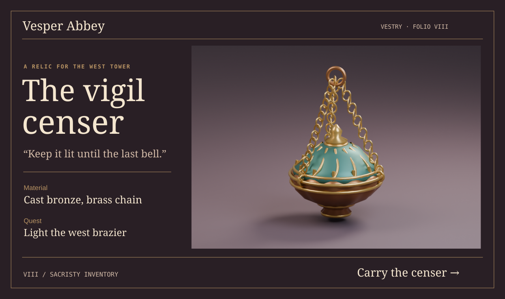

# Vesper Abbey · Relic RPG

В нижней часовне хранится печать звонаря. Игрок осматривает реликвию, выбирает клятву, покупает переправу и отмечает цель в западной башне.

[Открыть серию в Figma](https://www.figma.com/design/PcRRfGqam04HT5VkCCzrUK/Game-UI-Atlas?node-id=2-15) · [Увеличить превью](overview.png)

### На что посмотреть

Тонкая латунная рамка и гравюрная подача связывают предметы с одним местом. У реликвии есть своя полоса для рисунка; цену, остаток и действие можно читать отдельно. На переправе проверьте, можно ли заплатить: у игрока 12 марок, а билет стоит 8. В окне клятв видно, почему одна из двух пока недоступна.

| Окно | Что видит игрок |
| --- | --- |
| [Reliquary](https://www.figma.com/design/PcRRfGqam04HT5VkCCzrUK/Game-UI-Atlas?node-id=2-17) | Bellkeeper’s seal: Equipped · Choir glass: 2 shards |
| [The amber oath](https://www.figma.com/design/PcRRfGqam04HT5VkCCzrUK/Game-UI-Atlas?node-id=2-145) | Candle ward: Ready · Moon ward: Needs 1 hymn |
| [Pilgrim’s exchange](https://www.figma.com/design/PcRRfGqam04HT5VkCCzrUK/Game-UI-Atlas?node-id=2-274) | Silver marks: 12 held · Passage writ: 8 marks |
| [The west tower](https://www.figma.com/design/PcRRfGqam04HT5VkCCzrUK/Game-UI-Atlas?node-id=2-402) | Find the bell: Complete · Light the brazier: 1 of 2 |

### Пятый экран: Pilgrim’s satchel

Этот дополнительный экран приложен как [редактируемый SVG](detail.svg), а не как часть облачного макета. Скачайте файл и перетащите его на холст Figma. Векторные рисунки лежат в [art/](art/), отдельные иконки — в [icons/](icons/). При импорте SVG системный шрифт может отличаться.

В исходном макете: Fraunces и DM Sans. Цвета: `#201A22` · `#382A34` · `#FAE9CB` · `#DDB77A` · `#493547`.

[← Все серии](../../README.md)
